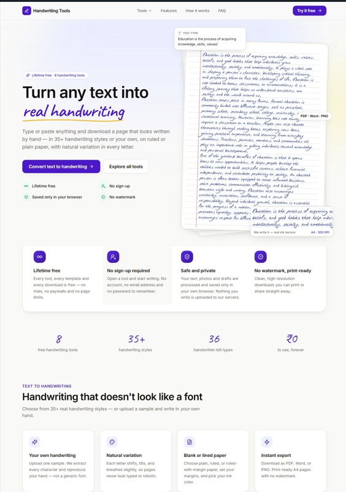
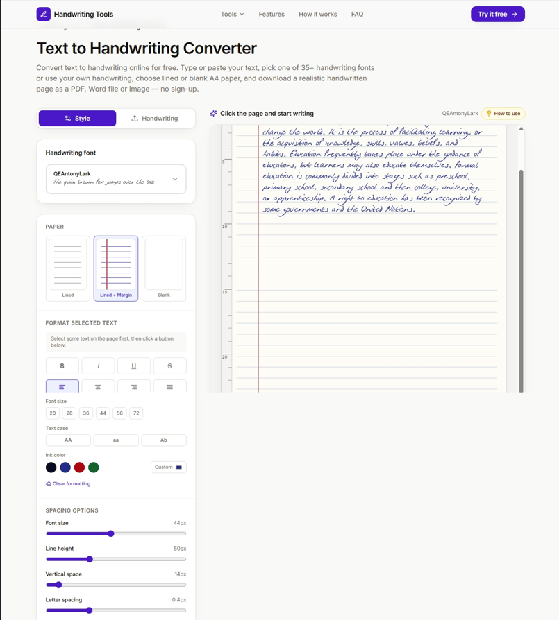
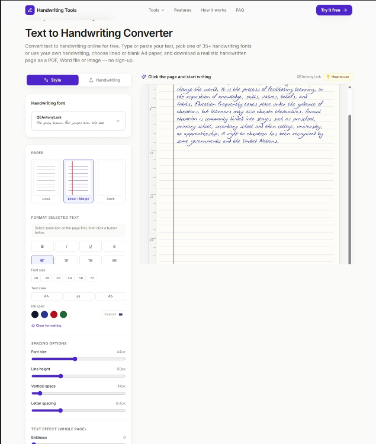
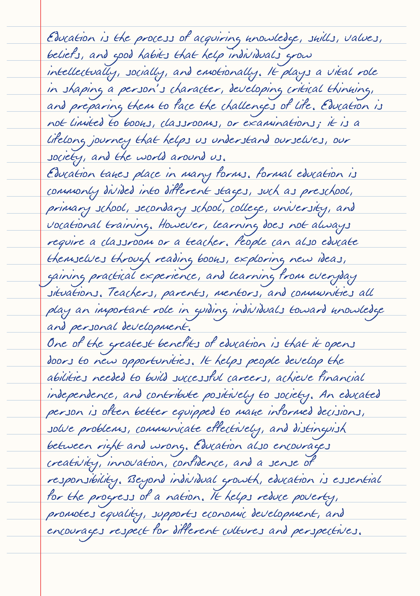

# Free Text to Handwriting Converter – Online Handwriting Generator

Looking for a free **text to handwriting converter**? LeaveTrackr offers an easy-to-use online handwriting generator that transforms ordinary typed text into realistic handwritten documents.

With this free online text to handwriting tool, you can convert digital text into handwritten notes, customize handwriting styles, upload your own handwriting sample, select different paper layouts, and download your handwritten documents in PDF, Word, or image formats.

Whether you are a student, teacher, writer, or someone who wants to create personalized handwritten documents, this online handwriting converter makes the process simple.

**Try the Free Text to Handwriting Converter:**

https://leavetrackr.com/tools/text-to-handwriting

---

## Table of Contents

- [Introduction](#introduction)
- [Screenshots](#screenshots)
- [Key Features](#key-features)
- [How to Convert Text to Handwriting](#how-to-convert-text-to-handwriting)
- [Generate Handwriting Using Your Own Writing Style](#generate-handwriting-using-your-own-writing-style)
- [Download Handwritten Documents](#download-handwritten-documents)
- [Who Can Use This Handwriting Generator](#who-can-use-this-handwriting-generator)
- [Frequently Asked Questions](#frequently-asked-questions)
- [Try the Free Online Tool](#try-the-free-online-tool)

## Introduction

A text to handwriting converter is an online tool that transforms digital text into handwritten-style documents.

Instead of manually writing long notes, assignments, letters, or other documents, users can enter their content into a handwriting generator and convert it into handwritten pages.

LeaveTrackr's online handwriting converter provides multiple customization options to help users create personalized handwritten documents.

One of its useful features is the ability to upload your own handwriting sample and generate new content that resembles your personal writing style.

**Explore the tool:** https://leavetrackr.com/tools/text-to-handwriting

## Screenshots

Here are some previews of the LeaveTrackr online text to handwriting converter and its generated handwritten output.

### 1. Text to Handwriting Converter – Home Page

Explore the online handwriting generator and its available features.

### 2. Handwriting Editor – Preview 1

Enter your text and customize the handwriting appearance using the available editor settings.

### 3. Handwriting Editor – Preview 2

Explore additional handwriting customization options and generate handwritten-style content.

### 4. Generated Handwritten Output

Preview how ordinary typed text is transformed into handwritten-style documents.

## Key Features

### 1. Convert Text to Handwriting Online

Transform ordinary typed text into handwritten-style documents directly in your browser.

Simply enter or paste your content into the editor and generate handwritten pages without manually writing everything.

### 2. Generate Text Using Your Own Handwriting

Create personalized handwritten documents using your own handwriting sample.

Upload your handwriting sample using the provided template and use it to generate content that resembles your writing style.

This feature makes the tool more personalized than traditional handwriting font generators.

### 3. Multiple Handwriting Customization Options

Customize the appearance of your handwritten content with different formatting options, including:

- Handwriting font selection
- Font size customization
- Custom ink colors
- Letter spacing
- Line height
- Text alignment
- Handwriting naturalness
- Additional formatting options

### 4. Different Paper Styles

Choose a paper layout according to your preferences.

Available paper styles include:

- Blank paper
- Lined paper
- Lined paper with margin

These layouts are useful for creating handwritten notes, notebook-style pages, and printable documents.

### 5. Download Handwritten Documents

Export your generated handwritten documents in different formats:

- **PDF:** Download handwritten pages as PDF documents.
- **Word (DOCX):** Export handwritten content in Word format.
- **Image:** Save handwritten pages as images.

### 6. Free Online Handwriting Generator

Use the handwriting converter directly through your web browser without installing additional software or creating an account.

## How to Convert Text to Handwriting

Follow these simple steps to generate handwritten documents online:

1. Open the [LeaveTrackr Text to Handwriting Converter](https://leavetrackr.com/tools/text-to-handwriting).
2. Type or paste your text into the editor.
3. Select your preferred handwriting font or upload your own handwriting sample.
4. Choose a paper style, such as blank paper or lined paper.
5. Customize font size, ink color, spacing, and other available settings.
6. Preview your generated handwritten document.
7. Download your document as PDF, Word, or an image.

Your typed text is now converted into handwritten-style content.

## Generate Handwriting Using Your Own Writing Style

One of the useful features of this online handwriting generator is the ability to use your own handwriting sample.

Traditional handwriting converters generally rely on predefined handwriting fonts. However, uploading your own handwriting sample provides an additional way to personalize the generated content.

This feature can be useful when you want to create handwritten-style documents that resemble your personal writing.

## Download Handwritten Documents

After customizing your handwritten content, you can export the generated document in your preferred format.

### PDF Export

Download your handwritten pages as PDF files for printing, sharing, and offline viewing.

### Word Document Export

Export your handwritten content in DOCX format for use with compatible word-processing applications.

### Image Export

Save handwritten pages as image files for sharing, presentations, and other creative purposes.

## Who Can Use This Handwriting Generator?

An online text to handwriting converter can be useful for different types of users.

### Students

Create handwritten-style study notes, revision materials, and personal learning resources.

### Teachers

Prepare handwritten-style worksheets and educational materials.

### Writers and Content Creators

Generate handwritten-style quotes, letters, and creative visual content.

### Professionals

Create personalized handwritten-style notes, letters, and printable documents.

## Frequently Asked Questions

### 1. Is there a free online text to handwriting converter?

Yes. LeaveTrackr offers a free online text to handwriting converter that allows you to enter text, customize handwriting, and download generated documents.

### 2. How can I convert typed text into handwriting?

Open the online handwriting generator, enter your text, choose a handwriting style, customize the document, and download the generated handwritten pages.

### 3. Can I convert text into my own handwriting?

Yes. You can upload your handwriting sample using the provided template and use it to generate personalized handwritten content.

### 4. Can I convert text to handwriting PDF?

Yes. You can export generated handwritten documents in PDF format.

### 5. Can I download handwritten documents in Word format?

Yes. The tool supports exporting handwritten content in Word (DOCX) format.

### 6. Do I need to install any software?

No. The converter works directly in your web browser.

### 7. Is this handwriting generator suitable for creating handwritten notes?

Yes. You can use different handwriting styles and paper layouts to create handwritten-style notes and printable documents.

## Try the Free Text to Handwriting Converter

If you are looking for an easy way to convert typed text into handwritten documents, try the LeaveTrackr online handwriting generator.

Create personalized handwritten content, customize your writing style, select your preferred paper layout, and download your documents in PDF, Word, or image format.

**Start converting text into handwriting for free:**

https://leavetrackr.com/tools/text-to-handwriting

---

## Additional Documentation

Want to understand how the handwriting converter works?

Read our detailed guide:

[How the Text to Handwriting Converter Works](docs/how-it-works.md)

---

## Related Keywords

Text to handwriting converter, text to handwriting online, free handwriting generator, online handwriting generator, handwritten text generator, handwriting text converter, convert text to handwriting, typed text to handwriting, text to handwritten notes, text to handwriting PDF, text to handwriting Word, realistic handwriting generator, own handwriting generator, handwritten notes generator.
